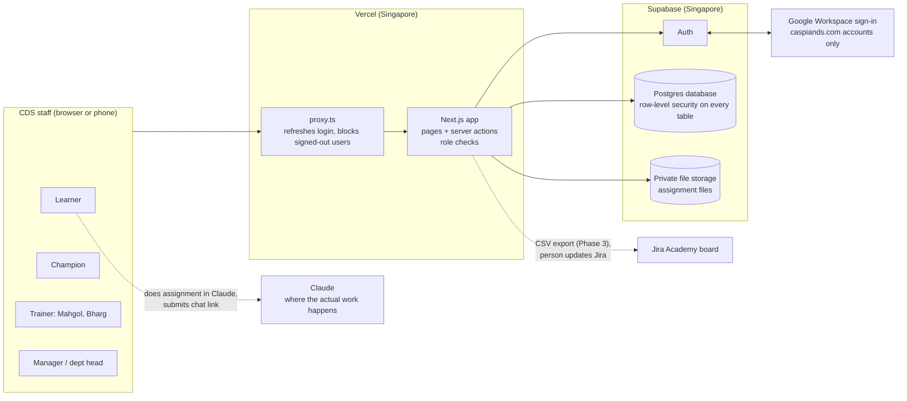
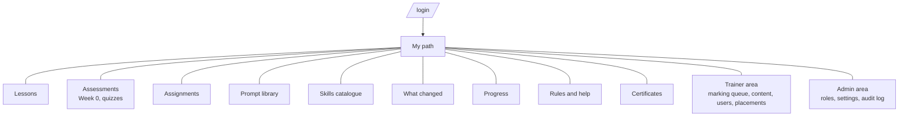
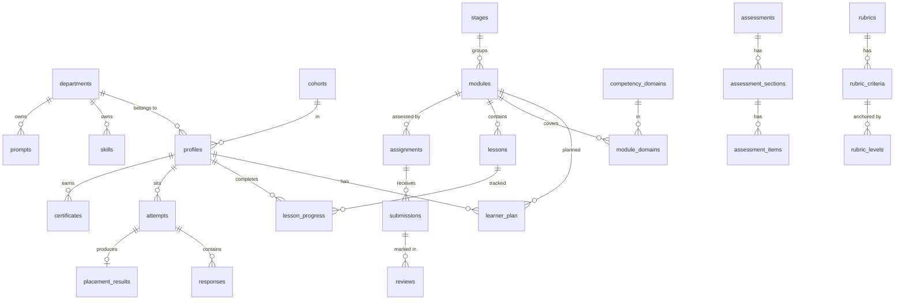
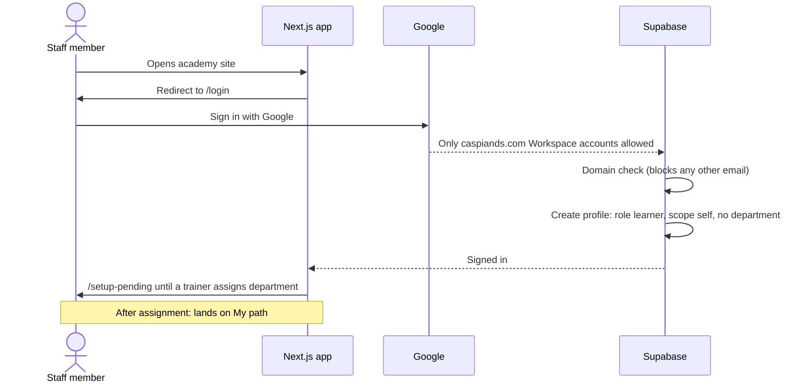
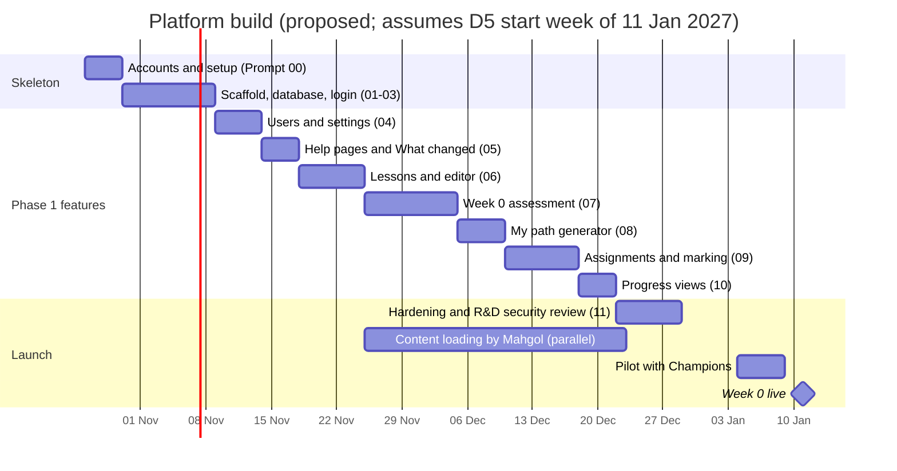

# CDS AI Academy Platform — System Architecture (v1.0, 20 Oct 2026, DRAFT)

Owner: Bharg (product owner) · Content and users: Mahgol · Security review: R&D
Status: proposal. Everything here is buildable now; items marked **[Pending]** need a management decision before production launch.

Label key used throughout:
- **[Confirmed]** checked against the vendor's own documentation on 20 Oct 2026
- **[Rec]** recommendation from this design
- **[Assumption]** working assumption, to be confirmed
- **[Pending]** decision awaiting approval (decision codes from DECISION_LOG.md)

---

## 1. What we are building, in one paragraph

A private CDS website where each staff member logs in with their CDS Google account, sees their own learning path based on their Week 0 result, reads short lessons, sits assessments, hands in assignments and gets rubric feedback. Trainers (Mahgol, Bharg, Champions) load content, mark work and see progress. Managers see raw progress counts for their team. The site also holds the prompt library, the Skills catalogue, the weekly "What changed" note and the data rules. Client work never happens here: it stays in Claude. The platform contains **no AI features** of its own. **[Rec]**

### What it is not
- Not a replacement for live workshops
- Not a place for client or personal client data
- Not another chatbot
- Not a copy of Jira (Jira remains the record for work)

---

## 2. Technology choices

| Layer | Choice | Why | Status |
|---|---|---|---|
| Web app | **Next.js 16** (React framework), TypeScript | React, as proposed in DL-016 and already in CDS's stack; adds server-side login checks that a plain React app lacks | [Confirmed] 16.4 is current (released 6 Oct 2026). [Rec] |
| Styling | Tailwind CSS + shadcn/ui components | Fast, consistent, accessible building blocks that Cursor knows well | [Rec] |
| Database | **Supabase** Postgres | Real database with row-level security; one vendor for data, login and files | [Rec] (DL-016) |
| Login | Supabase Auth with Google sign-in, CDS Workspace accounts only | Staff already use Google Workspace (Gmail, Drive, Calendar) | [Rec] [Pending D11] |
| File storage | Supabase Storage, private buckets | Assignment files; never public | [Rec] |
| Hosting | **Vercel** | Built by the Next.js team; preview link for every change | [Rec] (DL-016) |
| Region | Supabase Singapore; Vercel functions in Singapore | Nearest to Malaysia; low latency; PDPA cross-border transfer noted in §9 | [Rec] |
| Code editor | Cursor, using a Claude model | Bharg's chosen build tool | [Confirmed] (Bharg) |
| Tests | Vitest (logic), Playwright (key journeys) | Placement scoring and access rules must be provably right | [Rec] |

Supabase's current Next.js guide uses the `@supabase/ssr` package, a **publishable key** (`NEXT_PUBLIC_SUPABASE_PUBLISHABLE_KEY`) rather than the older "anon key", a `proxy.ts` file (Next.js 16 renamed `middleware.ts`), and `getClaims()` for protecting pages. **[Confirmed]** Cursor must follow this, not older tutorials.

---

## 3. System overview



Three locks protect every page, from outside in:
1. **Google** only lets CDS Workspace accounts sign in (consent screen set to "Internal"). **[Rec]**
2. **The app** checks login and role before showing a page or saving anything.
3. **The database** checks again with row-level security, so even a coding mistake in the app cannot expose another person's data.

---

## 4. Users and roles

Two separate settings per person: **role** (what you can do) and **progress scope** (whose progress you can see). Keeping them separate avoids hidden rules. **[Rec]**

| Role | Who | Can do |
|---|---|---|
| `learner` | Everyone by default | Own path, lessons, assessments, submissions, feedback, libraries, help |
| `champion` | One per department | Learner rights + double-mark own department's submissions + draft prompts and Skills entries for review |
| `manager` | Department heads, senior management | Learner rights + view progress within their progress scope |
| `trainer` | Mahgol, Bharg | Load and publish content, manage users (department, stream, cohort), mark work, confirm placements, view all progress |
| `admin` | Bharg (+ one named backup) | Everything, plus change roles, edit settings, view the audit log |

| Progress scope | Sees |
|---|---|
| `self` | Own progress only (default) |
| `department` | Own department's people |
| `all` | Everyone |

**Score visibility [Rec, to confirm with D4]:** individual assessment scores are visible to the learner, trainers and admin. Managers see per-person completion and certification status plus raw team counts, not individual test marks.

Only an admin can change a role. Every role, placement, mark and certificate change is written to the audit log.

---

## 5. Site map



| URL | Section | Who sees it | Phase |
|---|---|---|---|
| `/login` | Sign in with Google | Everyone | 1 |
| `/setup-pending` | "A trainer will finish setting up your account" | New users with no department | 1 |
| `/my-path` | Stream, this week, what is due, what you may skip | All signed in | 1 |
| `/lessons`, `/lessons/[module]`, `/lessons/[module]/[lesson]` | Lessons by module | All | 1 |
| `/assessments`, `/assessments/[code]` | Week 0 diagnostic, safety quiz, module checks | All | 1 |
| `/assignments`, `/assignments/[id]` | Briefs, submit, see feedback | All | 1 [Rec] |
| `/prompt-library` | Tested prompts, filter by department and task | All | 2 |
| `/skills`, `/skills/[name]` | Skills catalogue | All | 2 |
| `/what-changed` | Weekly tool-change notes | All | 1 |
| `/progress` | Raw counts, sortable, filterable | Scope-based | 1 (basic), 3 (management view) |
| `/help`, `/help/[page]` | Data rules, risk tiers, glossary, FAQ, who to ask | All | 1 |
| `/certificates` | Own certificates | All | 3 |
| `/trainer/*` | Marking queue, content editor, users, placements | trainer, admin (champion: marking only) | 1 |
| `/admin/*` | Roles, settings, audit log | admin | 1 |

---

## 6. Data model

Plain-language rule: one table per kind of thing. Every table has `id`, `created_at`, `updated_at`. Every table has row-level security switched on.



### 6.1 Reference data (seeded from CURRICULUM_MASTER v1.1) — Phase 1

| Table | Holds | Key columns |
|---|---|---|
| `departments` | Content, Creative, Performance (+ SEO, Paid, Analytics as children), Account Management, Senior Management; Finance/Ops and Tech delivery seeded **inactive** until D3 | `code`, `name`, `parent_id`, `is_active` |
| `competency_domains` | C1–C9 | `code`, `name`, `description` |
| `stages` | Assessment, Foundation, Practitioner, Apply and certify, Specialist | `code`, `name`, `week_start`, `week_end`, `sort_order` |
| `modules` | F1–F9, P1–P10, L1–L3, S1–S8 | `code`, `title`, `stage_id`, `week_start`, `week_end`, `live_hours`, `assessed_by`, `is_leadership` |
| `module_domains` | Which domains each module covers | `module_id`, `domain_id` |
| `department_domain_requirements` | Which domains each department needs at Practitioner level | `department_id`, `domain_id`, `required` |
| `cohorts` | Cohort name, start date, weekly slot | `name`, `start_date`, `slot` |
| `app_settings` | Editable rules, e.g. placement thresholds | `key`, `value` (JSON), `updated_by` |

### 6.2 People — Phase 1

| Table | Holds | Key columns |
|---|---|---|
| `profiles` | One row per signed-in person, created automatically at first sign-in | `id` (= login id), `email`, `full_name`, `department_id`, `role`, `progress_scope`, `stream`, `specialist_pathway`, `cohort_id`, `is_active` |

`stream` values: `foundation`, `practitioner`, `practitioner_fast_track`, `champion`. `specialist_pathway`: `business`, `builder`, `technical` or empty.

### 6.3 Learning — Phase 1

| Table | Holds | Key columns |
|---|---|---|
| `lessons` | Micro-lessons, written in Markdown | `module_id`, `slug`, `title`, `summary`, `body_md`, `video_url`, `duration_min`, `sort_order`, `department_ids` (empty = all), `status` (draft, published, archived), `version` |
| `lesson_progress` | Who finished which lesson | `user_id`, `lesson_id`, `completed_at` |
| `learner_plan` | Each person's module list | `user_id`, `module_id`, `status` (required, optional, tested_out, bridge, not_applicable), `reason`, `set_by` |

`learner_plan` is generated from stream + department rules and can be overridden by a trainer, with a reason recorded.

### 6.4 Assessment — Phase 1

| Table | Holds | Key columns |
|---|---|---|
| `assessments` | Week 0 diagnostic, safety quiz, module checks | `code`, `title`, `type` (placement, quiz, safety_quiz, capstone), `module_id`, `pass_mark_pct`, `max_attempts`, `items_per_attempt`, `version`, `status` |
| `assessment_sections` | Knowledge 25, Prompting 25, Department 25, Safety 15, Workflow 10, Technical supplement | `code`, `max_score`, `counts_in_total`, `gate_min` |
| `assessment_items` | Questions | `type` (profile, mcq, scenario, practical), `prompt_md`, `options`, `correct_option`, `explanation`, `difficulty`, `domain_id`, `points`, `department_id`, `rubric_id` |
| `attempts` | One sitting | `user_id`, `assessment_id`, `started_at`, `submitted_at`, `status` |
| `responses` | One answer | `attempt_id`, `item_id`, `answer`, `auto_score`, `marker_score`, `marker_id`, `comment` |
| `placement_results` | Week 0 outcome | `attempt_id`, `total`, `section_scores`, `suggested_band`, `suggested_stream`, `gates_failed`, `bridges`, `confirmed_stream`, `confirmed_by`, `confirmed_at` |

Placement rule: the system **suggests**, a trainer **confirms**. No one's stream changes without a named person confirming it. Thresholds (safety ≥ 9/15, prompting ≥ 15/25, bands 0–44 / 45–69 / 70–84 / 85–100, bridges for any domain under 60%) live in `app_settings`, not in code, because DL-002 and DL-003 are still PROPOSED. **[Rec]**

### 6.5 Assignments and marking — Phase 1 **[Rec: moved forward from Phase 2]**

| Table | Holds | Key columns |
|---|---|---|
| `rubrics` | Named rubric with version | `title`, `version` |
| `rubric_criteria` | Criteria and weights | `rubric_id`, `name`, `weight`, `sort_order` |
| `rubric_levels` | Anchored score descriptions | `criterion_id`, `score`, `descriptor` |
| `assignments` | Brief linked to a module | `module_id`, `title`, `brief_md`, `rubric_id`, `submission_types` (link, file, text), `due_rule`, `department_id`, `status` |
| `submissions` | A learner's hand-in | `assignment_id`, `user_id`, `link_url`, `file_path`, `text_md`, `data_declaration` (ticked "contains no client or personal data"), `status` (submitted, in_review, returned, resubmit_requested), `version` |
| `reviews` | A mark | `submission_id`, `reviewer_id`, `kind` (primary, double_mark, final), `criterion_scores`, `total`, `feedback_md`, `released_at` |

Why forward: F3 (safety quiz), F4 (rubric-marked prompt) and F5 (before/after pair) are assessed in Weeks 2–3. Without submission and marking in Phase 1, Foundation marking would run on spreadsheets for four weeks.

### 6.6 Content pages — Phase 1

| Table | Holds | Key columns |
|---|---|---|
| `pages` | Rules and help pages: data rules, risk tiers, glossary, FAQ, who to ask | `slug`, `title`, `body_md`, `version`, `owner_id`, `status` |
| `updates` | "What changed" notes | `title`, `body_md`, `tools` (list), `action_required`, `published_at` |

### 6.7 Libraries — Phase 2

| Table | Holds | Key columns |
|---|---|---|
| `prompts` | Tested CDS prompts | `title`, `department_id`, `task_type`, `tool` (claude, perplexity, chatgpt), `body`, `usage_notes`, `version`, `owner_id`, `status` (draft, tested, retired), `tested_at` |
| `skills` | Catalogue entry for each Claude Skill (the Skill itself lives in Claude) | `name` (lowercase-hyphen, never containing "claude" or "anthropic"), `display_name`, `department_id`, `owner_id`, `version`, `description`, `status` (draft, in_review, live, retired), `how_to_enable_md`, `test_set_passed_at`, `reviewed_by`, `live_since` |
| `skill_usage_logs` | Evidence of live use (department certification needs two weeks) | `skill_id`, `user_id`, `used_on`, `task`, `outcome` (kept, edited, discarded) |
| `baseline_tasks`, `time_logs` | Week 0 baseline and time-saved measurement, raw minutes only | `department_id`, `name`; `user_id`, `task_id`, `minutes_without_ai`, `minutes_with_ai`, `logged_on` |

### 6.8 Certification and operations — Phase 3

| Table | Holds | Key columns |
|---|---|---|
| `certificates` | Foundation, Practitioner, Specialist | `user_id`, `level`, `department_id`, `certificate_no`, `issued_by`, `issued_at`, `evidence` |
| `audit_log` (Phase 1) | Who changed what | `actor_id`, `action`, `table_name`, `row_id`, `before`, `after`, `at` |

---

## 7. How the main journeys work

### 7.1 First sign-in


### 7.2 Week 0 placement
Learner sits the diagnostic → multiple-choice items auto-scored → practical items marked by a trainer → system calculates section scores, band, gates and bridges using the thresholds in settings → trainer reviews and confirms the stream (Champion candidates also need a portfolio review) → learner plan is generated → learner sees My path.

### 7.3 Assignment
Learner reads the brief → does the work in Claude using sample or anonymised data → submits a Claude chat link or file and ticks the data declaration → appears in the marking queue → Mahgol marks against the rubric (Champion double-marks a sample; Bharg has the final say on certificate decisions) → feedback released → learner sees score and notes. Target: within two working days.

---

## 8. Phased delivery

Phases follow DL-016, with one proposed change: basic assignment submission and marking moves into Phase 1.



Schedule assumption **[Assumption]**: about 8 hours a week of Bharg's build time with Cursor; R&D review takes one week; Batch 2 assessment content is written before Prompt 07 needs real questions (the engine can be built and tested on sample items before then). Mahgol starts loading Foundation lessons as soon as the lesson editor exists (Prompt 06), in parallel with the remaining build.

The plan is tight: hardening and the R&D review fall in the last two weeks of December, when leave is likely. The first week of January is the only buffer. If Prompts 01–06 are not done by end of November, either move Week 0 (D5) or launch Phase 1 without the progress views (Prompt 10), which can follow in Week 1.

| Phase | Ready by | Contents |
|---|---|---|
| 1 | Before Week 0 | Login, users and roles, My path, Week 0 assessment, Foundation lessons, assignments and marking, Rules and help, What changed, basic progress, audit log |
| 2 | Week 5 | Practitioner lessons, prompt library, Skills catalogue and usage logs, time logs |
| 3 | Week 13 | Specialist content, certificates (PDF), management progress view, CSV export for the Academy Jira board |
| 4 | After Week 20 | New-joiner path, content review reminders, quarterly review |

---

## 9. Security, privacy and PDPA

| Control | How |
|---|---|
| Sign-in restricted to CDS | Google consent screen "Internal" + database domain check on every new account [Rec] |
| Every page behind login | `proxy.ts` redirects signed-out users; every server action re-checks the user |
| Least privilege in the database | Row-level security on every table; policies written per role and progress scope |
| Secret keys stay on the server | Supabase secret key used only in server code, never in the browser, never in Git |
| No client data | Data declaration on every submission; upload limits (PDF, DOCX, PNG, JPG, TXT, MD; 10 MB); Rules and help page states the rule; trainers reject submissions containing client data |
| Safe content | Markdown rendered with HTML stripped; video embeds only from approved hosts (Google Drive, YouTube) |
| Traceability | Audit log on roles, placements, marks, certificates, settings |
| Backups | Supabase Pro daily backups kept 7 days [Confirmed]; free tier has none |
| No third-party tracking | No ad or analytics trackers |

**Staff personal data:** the platform holds staff names, emails, scores and submissions. That is employee personal data under the amended PDPA, so it needs a stated purpose (training and certification), access limited by role, a retention period **[Rec: keep while employed plus 12 months]**, and an entry in CDS's data inventory for the DPO. Hosting in Singapore is a cross-border transfer; the PDPA amendments allow it where comparable protection exists. Governance owner (D2) to confirm. **[Pending D2, D11]**

---

## 10. Environments and running cost

| Environment | Purpose | Supabase | Vercel |
|---|---|---|---|
| Local | Bharg's laptop with Cursor | Dev project | `npm run dev` |
| Preview | Every pushed change gets a link | Dev project | Preview deployment |
| Production | Staff use this | Prod project (Pro) | https://ailearning.devteam-cds.tech (redirect from legacy Vercel hostname) |

| Item | Monthly cost | Source |
|---|---|---|
| Supabase Pro (production project) | from US$25 | [Confirmed] Supabase pricing page; includes daily backups, no pausing |
| Supabase Free (dev project) | US$0 | [Confirmed] Pauses after a week of inactivity, no backups: fine for dev only |
| Vercel Pro, 1 seat | US$20 | Hobby plan is for non-commercial use only, so a company tool needs Pro (secondary source; R&D to confirm on Vercel's terms) |
| Domain | US$0 | Subdomain of caspiands.com [Assumption] |
| **Estimate** | **≈ US$45 / month** | Before any usage overage; 40 users is well inside both plans' limits |

Running cost and hosting approval: **[Pending D11]**.

---

## 11. Code structure

```
cds-ai-academy/
├── AGENTS.md                  Rules every AI agent reads first
├── .cursor/rules/             Cursor rule files (.mdc)
├── docs/                      Architecture, build plan, decisions, prompts
├── public/                    Logo and static images
├── src/
│   ├── app/
│   │   ├── (auth)/login/            Sign-in page
│   │   ├── auth/callback/           Google sign-in return route
│   │   ├── (app)/                   Signed-in area with sidebar
│   │   │   ├── my-path/  lessons/  assessments/  assignments/
│   │   │   ├── prompt-library/  skills/  what-changed/
│   │   │   ├── progress/  help/  certificates/
│   │   │   ├── trainer/             Marking, content, users, placements
│   │   │   └── admin/               Roles, settings, audit log
│   │   └── setup-pending/
│   ├── components/
│   │   ├── ui/                      shadcn/ui building blocks
│   │   ├── layout/                  Sidebar, header, page shell
│   │   └── shared/                  Markdown viewer, empty states, tables
│   ├── lib/
│   │   ├── supabase/                client.ts, server.ts, proxy.ts helpers
│   │   ├── auth/                    getCurrentUser, requireRole
│   │   ├── placement/               Scoring rules (pure functions + tests)
│   │   └── types/database.ts        Generated from the database
│   └── proxy.ts                     Session refresh and sign-in redirect
├── supabase/
│   ├── migrations/                  Numbered SQL files, one per change
│   └── seed.sql                     Departments, domains, stages, modules
├── tests/                           Vitest and Playwright
├── .env.example                     Names of settings, no values
└── README.md
```

---

## 12. Design

The platform reuses the Academy materials' look so it feels like one programme **[Rec; confirm against CDS brand]**: warm off-white background `#F6F3EC`, navy `#14213D` for headings, orange accent `#E07A2F` (darker `#B4501F` for text on light), green `#2F7A4A` for success, DM Sans for text and Domine for headings, CDS logo top-left. Phone-first layouts, WCAG AA contrast, keyboard-usable, no tables wider than the screen (they scroll inside their own box). Dashboards show raw numbers with sorting and filtering, never AI scores or health ratings.

---

## 13. Open items

| Item | Owner | Blocks |
|---|---|---|
| D11 login method, hosting approval, running cost | Bharg + R&D, Matthew for cost | Production launch, not the build |
| D2 governance owner (PDPA sign-off for staff data) | Matthew | Production launch |
| Google Workspace admin to create the OAuth client with "Internal" consent screen | CDS Workspace admin [Assumption: R&D] | Prompt 03 testing |
| GitHub organisation for the repository | R&D [Assumption] | Prompt 00 |
| Who sees individual scores (linked to D4) | Matthew / governance owner | Phase 1 progress view defaults |
| Batch 2 assessment content (Deliverables 3, 4) | Bharg (with Claude) | Loading real Week 0 questions, not the engine build |
| Proposed: move assignments and marking into Phase 1 | Bharg | Updates DL-016 phase list and the co-trainer deck slide "How we build it" |

---

## 14. Glossary

| Term | Plain meaning |
|---|---|
| Next.js | A framework for building React websites; handles pages, server code and login checks |
| React | The library CDS already uses to build website screens |
| TypeScript | JavaScript with labels on data, so mistakes are caught before the site runs |
| Supabase | A hosted service giving us a database, logins and file storage |
| Postgres | The database engine inside Supabase |
| Row-level security (RLS) | Rules inside the database deciding which rows each person may read or change |
| Migration | A numbered file that changes the database structure; applied in order so every environment matches |
| Seed data | Starter data loaded into the database, e.g. the module list |
| Vercel | The hosting service that runs the website and makes a preview link for each change |
| Proxy (`proxy.ts`) | Code that runs before every page to refresh the login and turn away signed-out visitors |
| Server action | A function that runs on the server when someone submits a form |
| Publishable key / secret key | Two Supabase keys: the publishable one is safe in the browser because RLS protects data; the secret one bypasses RLS and must never leave the server |
| OAuth / Google sign-in | Letting Google confirm who someone is, so we never store passwords |
| Environment variable | A setting (like a key) kept outside the code, in `.env.local` or Vercel |
| Git, commit, push | Version history: a commit is a saved checkpoint; push sends it to GitHub |
| Preview deployment | A temporary copy of the site for checking a change before it goes live |
| Markdown | Simple text formatting (`#` for headings, `-` for bullets) used for lessons |
| shadcn/ui | A set of ready-made, accessible screen components copied into our code |
| Vitest / Playwright | Tools that automatically test logic (Vitest) and click through the site (Playwright) |
| Audit log | A permanent record of who changed what, and when |
