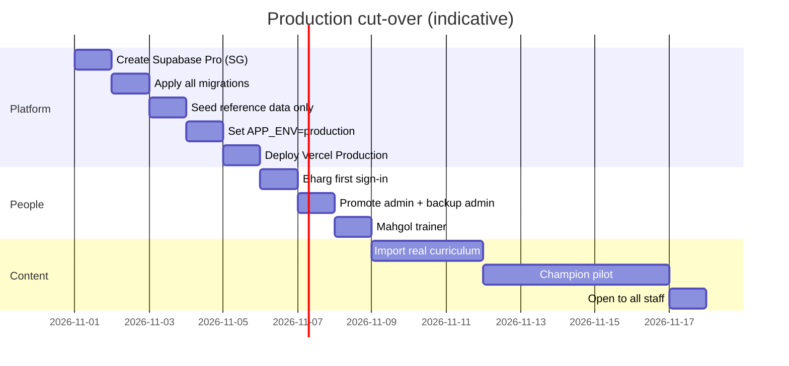

# Production cut-over plan (Prompt 11b — not executed in 11a)

**Status:** Document only. Do not create production accounts or spend money until **D11** (hosting and cost) and **R&D security sign-off** are complete.

## 1. Accounts and cost

| Item | Action | Owner |
|------|--------|-------|
| Supabase Pro | New project in **Singapore**; daily backups | Bharg + R&D |
| Vercel Pro | Production deployment; 1 seat minimum | Bharg + R&D |
| Domain | Confirm `ailearning.devteam-cds.tech` DNS with R&D | R&D |
| Google OAuth | Internal consent; production redirect URLs | Workspace admin |
| Cost | Re-check [Supabase](https://supabase.com/pricing) and [Vercel](https://vercel.com/pricing) on cut-over day (~US$45/mo starting point per Architecture §10) | Bharg |

## 2. Order of work

1. Create production Supabase project (Singapore).
2. Apply every file in `supabase/migrations/` (no manual drift).
3. Run **reference seed only** (`supabase/seed.sql` curriculum) — **no** demo people, **no** sample assessments in prod.
4. Set environment variables on Vercel Production, including `APP_ENV=production`.
5. Deploy commit approved for launch.
6. Bharg signs in; confirm first admin (SQL or app once configured).
7. Create backup admin; assign Mahgol as trainer.
8. Import real content; Champion pilot; general availability.

## 3. Rollback

- Point DNS back to previous host or maintenance page.
- Restore Supabase from **daily backup** (Pro, 7-day retention).
- Keep development project `qayhizszqgubbseevtwq` unchanged as the academy dev/staging database.

## 4. What moves vs what does not

| Moves to production | Stays on dev only |
|---------------------|-------------------|
| Migrations, reference seed, real staff accounts | `npm run demo:seed` / `demo:clear` |
| Published real content | Sample (`is_sample`) assessments and assignments |
| Production OAuth client | Test accounts (`is_test_account`) |
| | Dev answers and RLS test users |

## 5. Data export proof

`npx tsx scripts/export-snapshot.ts` on **development** proves CSV export works. Production backups remain Supabase Pro daily snapshots.

## 6. Owners

| Step | Owner | Sign-off |
|------|-------|----------|
| D11 cost approval | Bharg / Matthew | |
| R&D security review | R&D | `docs/security/R&D_REVIEW_CHECKLIST.md` |
| D2 privacy notice | Governance owner | |
| Cut-over execution | Bharg + agent | After above |
