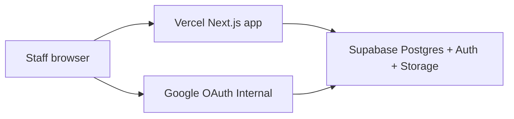

# Security overview — CDS AI Academy

**Audience:** R&D security review (Prompt 11a).  
**Last updated:** 22 Oct 2026.

## Architecture

## Data flows

| Flow | Path | Notes |
|------|------|-------|
| Sign-in | Browser → Google → `/auth/callback` → session cookie | CDS domain only; rate limited |
| Quiz answers | Server action → `responses` / `submit_attempt` | RLS; keys table trainer-only |
| Assignment files | Upload → private `submissions` bucket | Signed URLs; 10 MB limit |
| Marks | Trainer RPCs → `reviews` / `response_scores` | Champions double-mark sample only |

## Where data lives

| Data | Location | Region |
|------|----------|--------|
| Profiles, progress, marks | Supabase Postgres | Singapore |
| Submission files | Supabase Storage `submissions` | Singapore |
| Application | Vercel serverless | Singapore functions |

## Three locks

1. **Google Internal** — Workspace accounts only (`caspiands.com`).
2. **Application** — `src/proxy.ts`, layouts, server actions, `getClaims()`.
3. **Row-level security** — Every table; see `docs/ACCESS_RULES.md` and `ACCESS_MATRIX.md`.

## Secrets

- `SUPABASE_SECRET_KEY` server-only; never in Git or browser.
- Publishable key in browser; RLS enforces access.

## Response headers (Production)

| Header | Purpose |
|--------|---------|
| Content-Security-Policy | Restrict scripts, frames, and connect targets; allow Supabase, Google OAuth, Drive/YouTube embeds |
| Strict-Transport-Security | HTTPS only on production |
| X-Content-Type-Options | `nosniff` |
| Referrer-Policy | `strict-origin-when-cross-origin` |
| Permissions-Policy | Deny camera, microphone, geolocation |
| X-Frame-Options | `DENY` |

CSP details: `src/lib/security/headers.ts`.

## Rate limits

Per-user or per-IP counters in `rate_limit_events`, checked via `check_rate_limit` before sign-in callback, assessment save/submit, and assignment submit/upload. Plain-English errors only.

## Logging

Server errors log route, user id (UUID), and digest — never email, passwords, or full submission text. See `src/lib/security/log-server-error.ts`.

## Retention (proposed)

While employed **plus 12 months** after leaving (`profiles.left_at`). Governance owner (D2) to confirm.

## Production guards

`APP_ENV=production` blocks sample content and test-account sign-in. Demo scripts refuse production and wrong project ref.
